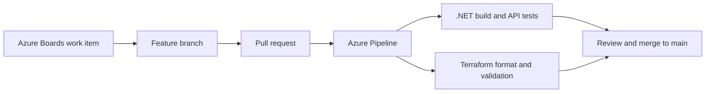

# Azure DevOps Delivery Lab

A portfolio lab demonstrating an Azure DevOps workflow around a small ASP.NET Core Service Status API. It combines Azure Boards work tracking, Git branches and pull requests, automated tests, Azure Pipelines CI, and Terraform infrastructure as code.

> **Current status:** API CI and Terraform validation are implemented. An authenticated Terraform plan previewed three Azure resources in East US; nothing has been provisioned or deployed.

## What this project demonstrates

- Organizing work in Azure Boards and linking changes to work items.
- Developing on feature branches and merging through pull requests.
- Running API integration tests automatically in Azure Pipelines.
- Describing Azure App Service infrastructure with Terraform.
- Validating Terraform in CI without automatically changing Azure resources.

## Workflow



The pipeline checks the application and Terraform configuration. It does not run `terraform plan` or `terraform apply`, and it does not deploy the API.

## Application

The API is in `src/ServiceStatus.Api`. Its `GET /health` endpoint returns HTTP 200 with a JSON status:

```json
{"status":"Healthy"}
```

Automated integration tests are in `tests/ServiceStatus.Api.Tests`.

### Run the API tests

Prerequisite: .NET 10 SDK.

```powershell
dotnet test .\tests\ServiceStatus.Api.Tests\ServiceStatus.Api.Tests.csproj --configuration Release
```

### Run the API locally

```powershell
dotnet run --project .\src\ServiceStatus.Api\ServiceStatus.Api.csproj
```

Use the local URL printed by `dotnet run` and append `/health` to check the endpoint.

## Infrastructure as code

Terraform configuration is in `infra/terraform`. It describes:

- An Azure resource group.
- A Linux App Service plan using the Free (`F1`) tier.
- A Linux Web App configured for .NET 10 and HTTPS, with Always On and publishing basic authentication disabled.

The F1 tier has significant limitations and availability can vary by region and subscription. Review current Azure pricing and the plan before provisioning resources. The repository does not yet configure remote Terraform state or Azure deployment credentials.

The current plan proposes three resources to add, with no changes or deletions. A successful plan is not a quota or capacity guarantee and is not a cost estimate.

### Validate Terraform without deploying

Prerequisite: Terraform CLI 1.16.5.

```powershell
Push-Location .\infra\terraform
terraform fmt -check -recursive
terraform init -backend=false -input=false -lockfile=readonly
terraform validate
Pop-Location
```

The AzureRM provider version is selected in `.terraform.lock.hcl`. Local `terraform.tfvars` files and Terraform state are ignored by Git. Never commit credentials or secrets.

`terraform plan` previews changes against Azure and requires authentication and input values. `terraform apply` creates or changes resources; neither command runs in the current pipeline.

## Azure DevOps pipeline

The pipeline definition is `azure-pipelines.yml`. It runs on pushes to `main` and `feature/*` and:

1. Selects the .NET 10 SDK and runs the API tests.
2. Installs a pinned Terraform CLI, verifies its download checksum, and runs Terraform formatting, initialization, and validation.

For Azure Repos pull requests, build validation is configured separately as a branch policy on `main`.

## Repository layout

| Path | Purpose |
|---|---|
| `src/ServiceStatus.Api` | ASP.NET Core health API |
| `tests/ServiceStatus.Api.Tests` | API integration tests |
| `infra/terraform` | Terraform configuration for Azure App Service |
| `azure-pipelines.yml` | CI pipeline definition |
| `docs/learning-notes.md` | Beginner-friendly concepts and lab journal |

See [Learning Notes](docs/learning-notes.md) for explanations of MCP, Azure Boards, Git, CI, Terraform, and the current lab status.

## Planned next steps

- Set up remote Terraform state before team-based plan or apply workflows.
- Review F1 availability and pricing before deciding whether to apply the plan.
- Add a controlled application deployment and post-deployment health check only after deployment is approved.
