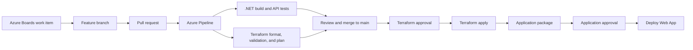

# Azure DevOps Delivery Lab

A portfolio lab demonstrating an Azure DevOps workflow around a small ASP.NET Core Service Status API. It combines Azure Boards work tracking, Git branches and pull requests, automated tests, Azure Pipelines CI, and Terraform infrastructure as code.

> **Current status:** The lab is complete and the Azure App Service infrastructure has been torn down. This repository still contains the API, tests, Terraform configuration, and Azure Pipelines definition needed to reproduce the workflow, but no deployed Web App, live endpoint, deployment URL, resource ID, run metric, or deployment outcome is asserted here. The deployment flow described below is implemented in the repository and requires a newly provisioned environment before it can run again.

## What this project demonstrates

- Organizing work in Azure Boards and linking changes to work items.
- Developing on feature branches and merging through pull requests.
- Running API integration tests automatically in Azure Pipelines.
- Describing Azure App Service infrastructure with Terraform.
- Planning Terraform changes in CI and applying the reviewed plan only after a manual environment approval.

## Workflow



The pipeline checks the application and Terraform configuration on `main` and `feature/*`. On `main`, it creates and publishes a Terraform plan artifact. The `Apply` stage is restricted to `main` and uses the `terraform-apply` environment, where configured approvals must complete before the reviewed plan is applied. After infrastructure succeeds, the pipeline publishes the ASP.NET application and can deploy it through the separately approved `app-deploy` environment. Feature branches never deploy infrastructure or application code. These are repository-defined behaviors; successful future execution depends on the required Azure resources, state backend, service connections, and environment approvals being available.

## Application

The API is in `src/ServiceStatus.Api`. Its `GET /health` endpoint returns HTTP 200 with a JSON status:

```json
{"status":"Healthy"}
```

Automated integration tests are in `tests/ServiceStatus.Api.Tests`.

### Run the API tests

Prerequisite: .NET 10 SDK.

```powershell
dotnet test .\tests\ServiceStatus.Api.Tests\ServiceStatus.Api.Tests.csproj --configuration Release
```

### Run the API locally

```powershell
dotnet run --project .\src\ServiceStatus.Api\ServiceStatus.Api.csproj
```

Use the local URL printed by `dotnet run` and append `/health` to check the endpoint.

## Infrastructure as code

Terraform configuration is in `infra/terraform`. It uses a separately created resource group and manages:

- A Linux App Service plan using the Free (`F1`) tier.
- A Linux Web App configured for .NET 10 and HTTPS, with Always On disabled and publishing basic authentication disabled.

The resource group `rg-service-status-lab` must be created separately; Terraform looks it up and uses its region. The apply identity is scoped to that resource group instead of the subscription. The F1 tier has significant limitations and availability can vary by region and subscription. Review current Azure pricing and the plan before provisioning resources. Remote Terraform state is configured in `infra/terraform/backend.tf` using a separate Azure Blob Storage account. Local Terraform uses Azure CLI/Microsoft Entra authentication. Azure Pipelines uses the plan and apply service connections for the remote backend and Azure operations. The previously provisioned App Service resources are no longer live after teardown; the repository does not retain verifiable Azure inventory or teardown-run evidence.

Historically, the reviewed plan described two App Service resources with no unrelated changes or deletions. A successful plan is not a quota or capacity guarantee and is not a cost estimate. The pipeline's plan and apply stages use separate Azure DevOps service connections named `sc-terraform-plan` and `sc-terraform-apply`. The application deployment reuses `sc-terraform-apply` and does not create a new Azure credential. No current resource inventory, endpoint, or deployment metrics are available in this repository.

### Validate Terraform without deploying

Prerequisite: Terraform CLI 1.16.5.

```powershell
az login
Push-Location .\infra\terraform
terraform fmt -check -recursive
terraform init -input=false -lockfile=readonly
terraform validate
Pop-Location
```

The Azure CLI identity needs Blob data access to the private state container. The AzureRM provider version is selected in `.terraform.lock.hcl`. Local `terraform.tfvars` files and any local Terraform state are ignored by Git; the active state is stored in Azure Blob Storage. Never commit credentials, secrets, or state files.

`terraform plan` previews changes against Azure and requires authentication, a subscription ID, and a globally unique Web App name. The region comes from the existing resource group. `terraform apply` creates or changes the App Service resources. The pipeline runs these commands only on `main` after the configured infrastructure approval.

## Application deployment

The `PackageApplication` stage runs only on `main` after validation, publishes the ASP.NET application with `dotnet publish`, verifies the published DLL and runtime configuration, and stores a flat ZIP package as the `app-package` pipeline artifact. The Web App expects `ServiceStatus.Api.dll` and `ServiceStatus.Api.runtimeconfig.json` at the ZIP root. The `DeployApplication` stage depends on both a successful infrastructure `Apply` and the package stage. If the named resources and approvals have been recreated, it uses `sc-terraform-apply` to run `az webapp deploy` against `rg-service-status-lab` and `service-status-lab-romy01`, cleaning the prior deployment target so stale nested files do not remain. The repository does not establish that a completed application deployment or `/health` verification occurred.

Before a future application deployment, configure the separate manual gate in Azure DevOps:

1. Open **Pipelines → Environments** and create an environment named `app-deploy`.
2. Add an approval/check and designate the intended approver.
3. Restrict the environment's pipeline permissions to this pipeline only.
4. Confirm `sc-terraform-apply` is authorized for this pipeline; no new service connection is required.

After approval, verify the recreated Web App's **Default domain** and request `/health`. No current domain is available because the infrastructure was torn down. The pipeline does not configure custom domains, deployment slots, monitoring, or automatic post-deployment remediation.

## Azure DevOps pipeline

The pipeline definition is `azure-pipelines.yml`. It runs on pushes to `main` and `feature/*` and:

1. Selects the .NET 10 SDK and runs the API tests.
2. Installs a pinned Terraform CLI and verifies its download checksum.
3. Runs Terraform formatting, initialization, and validation.
4. On `main`, runs `terraform plan` with the remote backend and publishes the plan as the `terraform-plan` artifact.
5. On `main`, waits for approval on the `terraform-apply` environment, then applies that reviewed plan with the apply service connection when the target infrastructure and backend are available.
6. On `main`, publishes the ASP.NET application as the `app-package` artifact after validation.
7. After infrastructure apply succeeds, waits for approval on the `app-deploy` environment, then deploys the package to the recreated Web App with the apply service connection.

For Azure Repos pull requests, build validation is configured separately as a branch policy on `main`.

## Repository layout

| Path | Purpose |
|---|---|
| `src/ServiceStatus.Api` | ASP.NET Core health API |
| `tests/ServiceStatus.Api.Tests` | API integration tests |
| `infra/terraform` | Terraform configuration for Azure App Service |
| `azure-pipelines.yml` | CI pipeline definition |
| `docs/learning-notes.md` | Beginner-friendly concepts and lab journal |

See [Learning Notes](docs/learning-notes.md) for explanations of MCP, Azure Boards, Git, CI, Terraform, and the current lab status.

## Reproduction notes

- Recreate the separately managed resource group and ensure the remote state backend, service connections, and environment approvals are available before running the deployment path.
- Review F1 availability and pricing, then run the validation and approved `main` pipeline flow if a live demonstration is required.
- Verify `/health` only against a newly deployed Web App; no historical endpoint or deployment result is recorded here.
