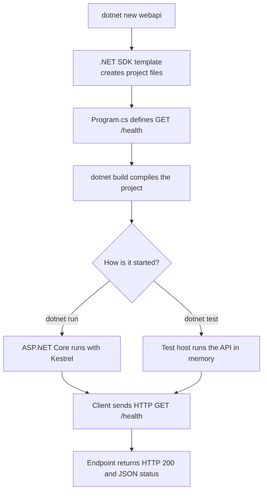

# Learning Notes

Use this page as a running glossary and lab journal. It explains the concepts used in this repository in beginner-friendly terms.

## Model Context Protocol (MCP)

**MCP is a standard way for an AI application to connect to external tools and data.** It is a protocol, not an AI model and not a cloud service by itself.

Think of the parts this way:

| Part | In this lab | What it does |
|---|---|---|
| AI host/client | GitHub Copilot in VS Code | Receives your request and decides whether a connected tool can help |
| MCP server | Microsoft's Azure DevOps MCP package, `@azure-devops/mcp` | Offers Azure DevOps operations as tools the AI host can call |
| External platform | Azure DevOps | Stores the project, repositories, Boards work items, and later pipelines |
| Authentication | Azure CLI sign-in | Identifies the user whose Azure DevOps permissions are used |

Here, **“MCP server” means the connector software, not the Azure DevOps platform**. In this lab, `@azure-devops/mcp` runs locally on your computer and exposes tools that Copilot can call. It then communicates with the separate Azure DevOps service. A remote MCP server uses the same general pattern, but the vendor hosts the connector instead of your computer.

For example, when you ask Copilot to list work items, Copilot can call an MCP tool. The Azure DevOps MCP server uses your configured authentication to request the data from Azure DevOps, and returns the result to Copilot. Creating or updating an item also changes Azure DevOps data, so review write operations before approving them.

An MCP server **does not** host this API, run its tests, create an Azure resource automatically, or grant permissions the signed-in user doesn't have. It makes a set of operations available; authentication and the platform's permissions still control what can happen. The server must also be configured, running, and its tools available in the agent session.

### Do platforms provide their own MCP servers?

Some platforms and vendors publish or maintain MCP servers; others have community-built integrations, several alternatives, or none. MCP is an open standard, so a server can be built by the platform vendor or by another developer. Before connecting one, verify who publishes it, what tools and permissions it requests, how it authenticates, and whether it is maintained.

Examples:

- [Microsoft Azure DevOps MCP Server](https://github.com/microsoft/azure-devops-mcp) and [Microsoft's setup documentation](https://learn.microsoft.com/en-us/azure/devops/mcp-server/mcp-server-overview?view=azure-devops).
- [AWS Labs MCP servers](https://github.com/awslabs/mcp), an AWS Labs open-source collection.

One provider can offer more than one server or connection mode. For example, Azure DevOps has a hosted remote server and a local server process. The remote mode is simpler when its Entra sign-in works in the client. This lab uses the local process with Azure CLI authentication.

### MCP security reminders

- MCP tools act with the permissions of their configured identity. Give them only the access needed for the task.
- Read-only requests retrieve information; write tools can create, edit, or delete platform data.
- Keep credentials out of repository files. This lab's `.mcp.json` contains configuration, not a PAT or password.
- Never paste passwords, access tokens, or one-time device codes into chat or commit them to Git.

## Azure Boards work items

Work items are records in Azure Boards that describe and track work. Parent-child links group a large outcome, a body of work, and its concrete steps.

This project uses Azure DevOps' **Basic** process, which uses this hierarchy:

| Level | Plain-language meaning | Lab example |
|---|---|---|
| **Epic** | The big outcome | #1 — Deliver a reliable Service Status API |
| **Issue** | A substantial piece of work toward the outcome | #2 — Implement and test the Service Status API |
| **Task** | A specific action that helps complete the Issue | #3 — Add automated health endpoint tests |

In the Basic process, **Issue** is a work-item type; it doesn't necessarily mean a defect or something broken. Other Azure Boards processes use different names and hierarchies. For example, the Agile process commonly uses Epic, Feature, User Story, and Task. The process determines which work-item types are available, so this project uses Issue rather than Feature.

Analogy: the Epic is “build a house,” an Issue is “build the kitchen,” and Tasks are actions such as “install the sink.” The hierarchy helps people see how daily work contributes to a larger goal.

## Git and the lab workflow

- The **repository** is the version-controlled home for the API, tests, pipeline YAML, Terraform, and documentation.
- A **branch** is a separate line of work. `feature/2-service-status-api` keeps this change separate from `main`.
- A **commit** is a saved checkpoint in Git history. Until files are committed, they exist only as local working-tree changes.
- A **pull request (PR)** proposes merging a branch into `main` and provides a place for review and automated checks.
- A **pipeline** automates build/test/deploy steps. Terraform will describe the Azure infrastructure that the deployment needs.

The intended path is: track work in Boards → change code on a branch → run tests → commit and push → review a PR → run an Azure Pipeline → provision/deploy with Terraform.

In `git commit -m "..."`, `-m` supplies a commit-message paragraph. Repeating `-m` adds another paragraph. In this lab, the first paragraph is the summary, `AB#2 AB#3` references the Azure Boards work items, and `Co-authored-by: ...` is a Git commit trailer. A commit is local; `git push` uploads it to the Azure DevOps remote.

## Automated tests

The API project is the application. The test project is a separate program that checks the application automatically. A project reference lets the test project use the API code. `Microsoft.AspNetCore.Mvc.Testing` can start the API in memory, so a test can send an HTTP request to `/health` without deploying the app to Azure.

Run the tests from the repository root with:

```powershell
dotnet test .\tests\ServiceStatus.Api.Tests\ServiceStatus.Api.Tests.csproj
```

The current test checks that `/health` returns HTTP 200 and a JSON `status` of `Healthy`.

## Azure Pipelines and continuous integration

The root `azure-pipelines.yml` file is a recipe for Azure Pipelines. When configured, Azure DevOps starts a build agent, checks out the repository, selects the .NET 10 SDK, and runs the test project. The agent reports success or failure; this pipeline does not deploy the API or create Azure resources.

**Continuous integration (CI)** means automatically building and testing code when changes are pushed. This pipeline is configured for pushes to `main` and `feature/*` branches. For an Azure Repos Git pull request, PR validation is enabled separately through a **Build validation** branch policy on the target branch; it isn't configured with a YAML `pr:` trigger.

## What is an API?

An API is a defined way for one program to request something from another. A web API uses HTTP requests and responses. It can be a complete, small server-side application even when it has no web page, user interface, or database.

## What is an SDK?

**SDK** means **Software Development Kit**: a collection of developer tools and supporting libraries for building software for a platform. The .NET SDK installed for this lab includes the `dotnet` command, project templates, a C# compiler, and build/test tooling. It also installs the .NET and ASP.NET Core runtimes needed to run the application.

The SDK helps with different stages; it doesn't write the API's behavior for us:

| Command or component | Role in the lab |
|---|---|
| `dotnet new webapi` | Uses an SDK template to create starter project files |
| `dotnet restore` | Downloads the project's declared NuGet dependencies |
| `dotnet build` | Compiles our C# source and references into application output |
| .NET / ASP.NET Core runtime | Runs the compiled application and web-server framework |
| `dotnet test` | Builds the projects and runs tests with the test runner |

Analogy: the SDK is the workshop's tools and equipment; the API source code is the design we build with them. Installing the SDK makes the commands available, but we still write the endpoint behavior.

### How Terraform is similar—and different

Both .NET and Terraform require command-line tools installed on the machine or agent that runs them. The .NET SDK includes the `dotnet` CLI plus a compiler, templates, and runtime tooling. Terraform is usually installed as the **Terraform CLI** (`terraform`); it isn't normally called a Terraform SDK.

Terraform reads infrastructure configuration written in HCL. `terraform init` downloads the configured provider plugins (for example, AzureRM), `terraform plan` previews proposed infrastructure changes, and `terraform apply` carries them out. The provider plugin translates Terraform's resource definitions into calls to the cloud platform.

| Toolchain | Main job |
|---|---|
| .NET SDK / `dotnet` CLI | Create, compile, test, and run application code |
| Terraform CLI + provider plugins | Plan and manage infrastructure such as Azure resources |

Both are installed developer toolchains, but they solve different problems: .NET builds the API software; Terraform describes and manages the infrastructure that can host it.

The .NET `webapi` template created a runnable ASP.NET Core project. In this lab, `Program.cs` configures and starts the web server and defines one endpoint:

```csharp
app.MapGet("/health", () => Results.Ok(new { status = "Healthy" }));
```

This means: when a client sends an HTTP `GET` request to `/health`, return HTTP 200 and a JSON response like `{"status":"Healthy"}`. A monitoring service, another application, or a test can make that request. The API is the server-side service; a separate front end could call it, but a front end isn't required for this lab.

### Where this API came from

The .NET SDK includes a `webapi` project template. Running `dotnet new webapi` asked that template to create starter source files in this repository. We then changed `Program.cs` so the starter project serves our health endpoint. The API's behavior is in our code; the template supplied the starting structure and ASP.NET Core supplies the web-server framework.



`dotnet run` starts the service for local use, usually at a localhost URL. The automated test uses an in-memory test host instead, so it can check the same endpoint without deploying it or opening a public network port.

## Current lab status

- Azure DevOps project: `Azure-DevOps-Delivery-Lab`
- Azure DevOps organization: `romy33`
- Azure Boards items: Epic #1 → Issue #2 → Task #3
- Local Git branch: `feature/2-service-status-api`
- API: .NET 10 ASP.NET Core project in `src/ServiceStatus.Api`, with a `/health` endpoint returning HTTP 200 and `{"status":"Healthy"}`
- Tests: xUnit project in `tests/ServiceStatus.Api.Tests`
- Pipeline recipe: `azure-pipelines.yml` runs tests on `main` and `feature/*`; it hasn't been configured/run in Azure Pipelines yet, and `main` still needs a PR build-validation policy
- MCP: local Azure DevOps MCP server configured in root `.mcp.json`, using Azure CLI authentication
- Commits: `6c55ef6` (`Create and test Service Status API`) and `4ea4917` (`Update lab learning notes`) are pushed on `feature/2-service-status-api`
- Pull request: #1 is open; it hasn't been merged
- Not done yet: configure/run Azure Pipelines, add PR validation policy, Terraform infrastructure, or Azure deployment

Check `git status` before making more changes or switching branches.
